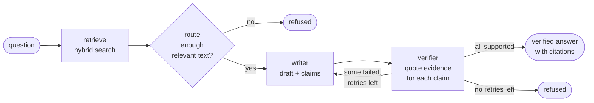

# VeriRAG

[](https://github.com/Rodolphe27/verirag/actions/workflows/ci.yml)


**A multi-agent question answering assistant that checks every claim of its answer against the
source documents, and refuses to answer when it cannot.**

Most document chatbots return fluent text whether or not the documents support it. VeriRAG adds a
second agent whose only job is to catch that. An answer is shown only if each of its claims is
backed by a quote that really exists in a retrieved passage. Otherwise you get a refusal that says
why and points to the closest text.

```text
$ verirag ask "Which AI practices are prohibited?"
Verified answer:
The AI practices listed in Article 5 are prohibited. ...

Sources:
  - ai-act-article-005.md

$ verirag ask "What is the capital of France?"
No verified answer.
I am not sure, so I will not guess: the documents contain nothing related to the question.
```

## Contents

- [How it works](#how-it-works)
- [Quick start](#quick-start)
- [Usage](#usage)
- [Configuration](#configuration)
- [Results](#results)
- [Project structure](#project-structure)
- [Design decisions](#design-decisions)
- [Development](#development)
- [Limits and roadmap](#limits-and-roadmap)
- [Sample data and licence](#sample-data-and-licence)

## How it works

A question goes through a small team of agents, connected as a graph (built with LangGraph):



1. **Retrieve.** Hybrid search: meaning (local multilingual embeddings) and keywords (BM25),
   combined with Reciprocal Rank Fusion. Works across German and English.
2. **Route.** If no retrieved passage is close enough to the question (cosine score below 0.30), the
   system refuses at once, without calling a model.
3. **Write.** The writer answers using only the numbered passages and lists its claims, one fact
   each, with the passages it relies on.
4. **Verify.** The verifier judges each claim. A claim counts as supported only if the verifier also
   **quotes the proof, and the code confirms the quote exists** in a retrieved passage. A made-up
   justification cannot pass.
5. **Retry or refuse.** Failed claims are sent back to the writer as feedback, at most twice. After
   that the system refuses, with the reason.

Citations in the final answer come from the verified quotes, not from what the writer claimed.

More detail: [architecture](docs/architecture.md) and the
[decision records](docs/adr/).

## Quick start

You need Python 3.11 or newer and, for answers, a free
[Gemini API key](https://aistudio.google.com/apikey) (or an Anthropic key).

```bash
git clone https://github.com/Rodolphe27/verirag.git
cd verirag
python3 -m venv .venv && source .venv/bin/activate
pip install -e ".[dev]"

export GEMINI_API_KEY="your-key"        # or put it in a .env file (it is git-ignored)

verirag index docs/sample               # first run downloads the embedding model (~220 MB)
verirag ask "What is the maximum fine for a prohibited AI practice?"
```

`docs/sample` holds 14 articles of the EU AI Act, public text with no personal data. To use your
own documents, point `verirag index` at a folder of `.md`, `.txt` or `.pdf` files.

### With Docker

```bash
docker build -t verirag .
docker run --rm -e GEMINI_API_KEY verirag ask "Which AI practices are prohibited?"
```

The image contains the program, the embedding model and an index of the sample documents. The key is
passed at run time and is never stored in the image.

## Usage

| Command | What it does |
|---|---|
| `verirag index <folder>` | Reads the documents into the index. Only new or changed files are embedded again. |
| `verirag ask "<question>"` | Prints a verified answer with its sources, or a refusal with the reason. |
| `verirag ask "<question>" --trace` | Also prints every agent step to the error stream. |
| `verirag ask "<question>" --trace-file run.jsonl` | Also saves the steps as JSON lines. |
| `verirag evaluate` | Measures the search on `eval/questions.json` for three search modes. |
| `verirag evaluate --end-to-end --output out.json` | Also runs the whole system on every question. |
| `verirag serve` | Starts an [MCP server](docs/mcp.md) so AI applications can use the documents as tools. |

`--index <file>` (before the command) chooses another index file.

**Exit codes of `ask`:** `0` verified answer, `2` refused (a normal outcome), `1` error (missing
index, missing key, network problem). A script can therefore tell "no answer" from "something broke".

**Reading a trace.** Each step is recorded with its data, for example:

```text
[retriever] {'chunks': 4, 'best_score': 0.859}
[router]    {'route': 'documents', 'reason': ''}
[writer]    {'attempt': 1, 'claims': 2}
[verifier]  {'attempt': 1, 'claims': 2, 'unsupported': 1, 'failures': [{'claim': '...', 'reason': '...'}]}
[writer]    {'attempt': 2, 'claims': 1}
[verifier]  {'attempt': 2, 'claims': 1, 'unsupported': 0, 'failures': []}
[finish]    {'status': 'answered', 'citations': 1}
```

### From Python

```python
from pathlib import Path

from verirag.assistant import Assistant
from verirag.llm.factory import create_llm
from verirag.retrieval.embedding import FastEmbedder
from verirag.retrieval.index import load_retriever
from verirag.tracing import JsonlTracer

retriever = load_retriever(Path(".verirag/index.json"), FastEmbedder())
assistant = Assistant(retriever, create_llm(), JsonlTracer(Path("run.jsonl")))

answer = assistant.ask("Do people have to be told that they are talking to a chatbot?")
print(answer.status, answer.text, answer.citations)
```

## Configuration

Settings come from the environment, or from a `.env` file in the current folder (a value set in the
terminal wins over the file).

| Variable | Default | Meaning |
|---|---|---|
| `VERIRAG_LLM` | `gemini` | Which model provider: `gemini` or `anthropic`. |
| `GEMINI_API_KEY` | none | Required for `gemini`. |
| `GEMINI_MODEL` | built-in list | Preferred Gemini model; the built-in ones are tried after it. |
| `ANTHROPIC_API_KEY` | none | Required for `anthropic`. |
| `ANTHROPIC_MODEL` | `claude-haiku-5-5` | Anthropic model. |
| `VERIRAG_INDEX` | `.verirag/index.json` | Where the index file lives. |

Other options: `--min-score` (default `0.30`) sets how close the passages must be before the system
tries to answer.

## Results

Measured with commands in this repository, on 35 questions about the sample documents (27 with an
answer, 8 without). Full method, limits and per-question results: [docs/evaluation.md](docs/evaluation.md).

**Search: does it find the right article?** (a correct article among the 4 best passages)

| Search mode | Hit rate@4 | MRR |
|---|---|---|
| meaning only | 93% | 0.84 |
| keywords only | 74% | 0.57 |
| **hybrid (default)** | **96%** | **0.87** |

{{E2E}}

## Project structure

```text
src/verirag/
├── domain/        plain data types (Chunk, Claim, Verdict, Draft, Answer); standard library only
├── ports.py       interfaces the core needs: LLM, Retriever, Tracer
├── agents/        writer, verifier, router, and the graph that connects them
├── assistant.py   one call, ask(question), that assembles the agents
├── llm/           model adapters (Gemini, Anthropic), HTTP retry, provider choice
├── retrieval/     chunking, BM25, embeddings, fusion, the index file
├── tracing/       step recorders (memory, JSON lines)
├── evaluation/    question sets and metrics
├── mcp_server.py  MCP tools
└── cli.py         the verirag command and the composition root
tests/             unit, graph, adapter and integration tests (fakes instead of real models)
eval/              evaluation questions and saved results
docs/              architecture, decision records, evaluation, MCP guide, sample documents
scripts/           builds the sample corpus from the Official Journal
```

## Design decisions

- **One program, strict module borders** (a modular monolith), with ports and adapters around the
  model, the search and the log. The dependency directions are checked in CI.
  [ADR 1](docs/adr/0001-modular-monolith-with-ports-and-adapters.md)
- **Refuse instead of guessing.** No path releases an unverified answer.
  [ADR 2](docs/adr/0002-refuse-instead-of-guessing.md)
- **LangGraph, kept thin.** Only one file knows about it.
  [ADR 3](docs/adr/0003-langgraph-for-orchestration.md)
- **Local embeddings and hybrid search.** Private, free, German and English.
  [ADR 4](docs/adr/0004-local-embeddings-and-hybrid-search.md)
- **The verifier's evidence is checked by code**, not trusted.
  [ADR 5](docs/adr/0005-verifier-evidence-is-checked-by-code.md)

## Development

```bash
pip install -e ".[dev]"
ruff check . && ruff format --check .     # style
mypy                                      # types (strict)
lint-imports                              # architecture rules
pytest                                    # tests, no network and no API key needed
VERIRAG_MODEL_TESTS=1 pytest              # also runs the test that loads the real embedding model
```

The regular tests replace the language model with a scripted fake, so they are fast, free and give
the same result every time. CI runs all checks on every push, and also builds the Docker image and
runs it. The work was planned and tracked as small issues on the
[project board](https://github.com/users/Rodolphe27/projects/13).

## Limits and roadmap

Known limits, stated plainly:

- **The evaluation is small.** 35 questions, one corpus, written by the author. It is a smoke test,
  not a benchmark.
- **Verification checks that the proof exists, not that it entails the claim.** The code confirms the
  quoted words are in a passage. Whether those words logically support the claim is still the
  verifier model's judgement.
- **The Anthropic adapter is tested with mocked HTTP only.** The Gemini adapter has been run live.
- **Costs and latency are not measured.** A verified answer takes at least two model calls, up to six.
- **The index is a JSON file read into memory.** Fine for hundreds of documents; a vector database
  behind the `Retriever` port would be the next step for more.
- **No web interface.** The command line, the Python API and MCP are the interfaces.

Ideas for next steps: an entailment check as a second layer for claims, per-question cost and latency
in the evaluation, a larger and independently labelled question set, a vector database adapter.

## Sample data and licence

The sample documents are articles of Regulation (EU) 2024/1689 (the EU AI Act), taken from the
Official Journal of the European Union, whose legal text may be reused with acknowledgement of the
source. They are a convenience copy for testing, not legal advice; only the Official Journal version
is authentic. See [docs/sample-corpus.md](docs/sample-corpus.md).

The code is released under the [MIT licence](LICENSE).
