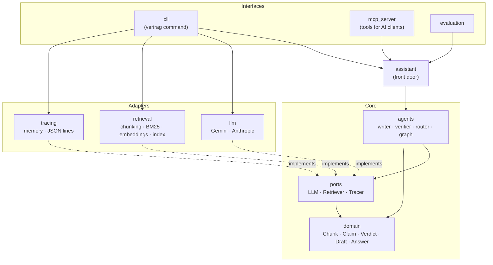
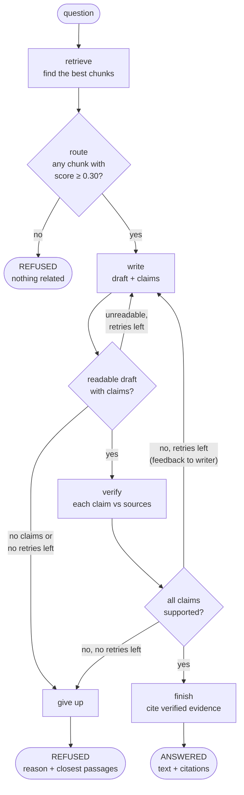
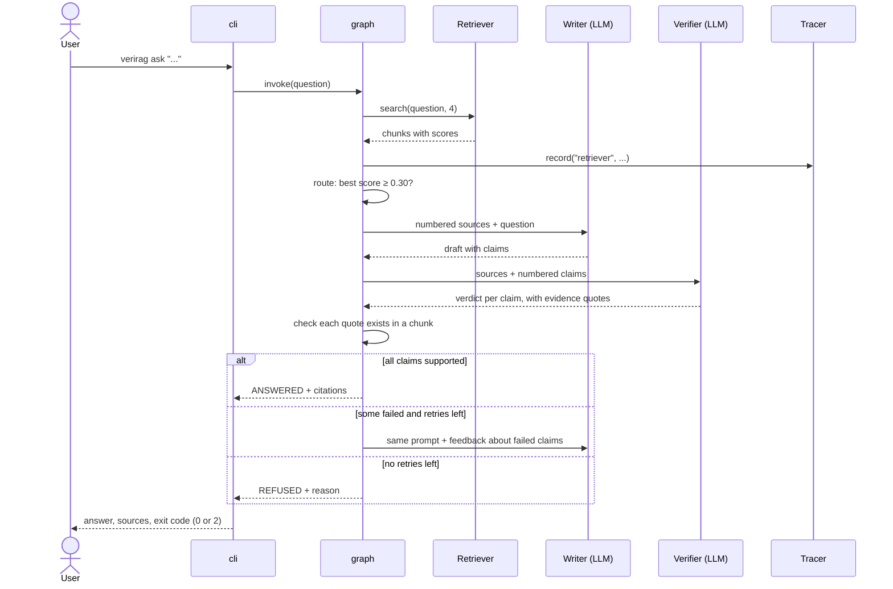

# Architecture

VeriRAG answers questions from a set of documents and checks every claim of the answer against
those documents before showing it. If the claims cannot be verified, it says so and refuses to
guess.

This page explains how the program is divided, how the agents work together, and which rules
keep the design from drifting. The reasons behind the main choices are in the
[decision records](adr/).

## 1. Shape: a modular monolith

VeriRAG is **one program** (one process, one package) divided into **modules with strict
borders**. It is not a set of services talking over a network: for this size, that would add
failure modes and no benefit. Where a module needs to talk to the outside world (a model, a
search, a log file) it does so through a small interface, a **port**, and the real thing is an
**adapter**. This style is called hexagonal architecture, or "ports and adapters".
See [ADR 1](adr/0001-modular-monolith-with-ports-and-adapters.md).

Arrows point from the user of something to the thing used. The dotted arrows mean "implements
the interface of". Nothing in the core points at an adapter.

| Module | Responsibility | Knows about |
|---|---|---|
| `domain` | Plain data types: `Chunk`, `Claim`, `Verdict`, `Draft`, `Answer`. Validates itself. | the standard library only |
| `ports` | Interfaces the core needs: `LLM`, `Retriever`, `Tracer`; the `LLMError` exception. | `domain` |
| `agents` | The writer, verifier and router, and the graph that connects them. | `domain`, `ports`, the graph library |
| `assistant` | One call, `ask(question)`, that assembles the agents. | `agents`, `ports` |
| `llm` | Adapters for Gemini and Anthropic, shared HTTP retry, provider choice. | `ports` |
| `retrieval` | Chunking, keyword search, local embeddings, fusion, the index file. | `domain` |
| `tracing` | Adapters that record each step (in memory, as JSON lines, or both). | `ports` |
| `evaluation` | Question sets and metrics (retrieval and end to end). | `ports`, `domain` |
| `mcp_server` | Exposes search and verified answers as MCP tools. | `assistant`, `ports` |
| `cli` | The `verirag` command and the **composition root**: the one place that creates the real objects and connects them. | everything |

### The rules are checked, not just written

The dependency directions above are enforced by `import-linter` contracts in `pyproject.toml`,
and CI runs them on every push. For example, adding `import numpy` to a `domain` file fails the
build and prints the exact line. Five contracts exist (domain is standard-library only; ports
depend on domain only; agents know no adapter; the three adapter packages do not know each other;
adapters do not know agents or interfaces).

## 2. The agent graph

Every path ends in an `Answer` whose status is `ANSWERED` or `REFUSED`. Nothing else can leave
the graph.

**The state** that travels through the graph: the question, the chunks, the draft, the verdict,
the number of writer attempts, and the feedback for the writer. Each node returns only what it
changes.

**The nodes**

| Node | Uses a model? | What it does |
|---|---|---|
| `retrieve` | no | Hybrid search (meaning + keywords) returns the 4 best chunks, each with its cosine score. |
| `route` | no | Refuses if no chunk reaches the minimum score (0.30 by default). Drops weak chunks. |
| `write` | yes | Writes an answer from the numbered chunks and lists its claims with source numbers. |
| `verify` | yes | Judges each claim against all chunks. A supported claim must come with a quote. |
| `finish` | no | Builds the final answer. Citations come from the quotes the verifier proved. |
| `give_up` | no | Builds the refusal with a reason and the closest passages. |

**Why there is no "answer directly" path.** An answer that skips the verifier would be
unverified, which is exactly what the project exists to prevent. See
[ADR 2](adr/0002-refuse-instead-of-guessing.md).

## 3. What stops bad behaviour

| Risk | Defence | Where |
|---|---|---|
| The question is unrelated to the documents | Score gate: refuse when no chunk reaches the minimum score | `agents/router.py` |
| The sources do not contain the answer | The writer returns no claims, and the system refuses at once | `agents/graph.py` |
| The model invents a fact | The verifier must quote evidence, and the **code** checks the quote exists in one chunk | `agents/verifier.py` ([ADR 5](adr/0005-verifier-evidence-is-checked-by-code.md)) |
| The verifier is vague, silent or unreadable | Doubt means "not supported": a missing or unreadable verdict fails the claim, an empty verdict is never a pass | `domain/verdict.py`, `agents/verifier.py` |
| The loop never ends | At most `max_retries + 1` writer calls (3 by default); every path ends in an answer | `agents/graph.py` |
| The model returns broken JSON | `BadModelOutput`; the writer is reminded of the format and retried, then the system refuses | `agents/output.py`, `agents/graph.py` |
| A document contains instructions ("ignore your rules") | Prompts tell both agents that sources are data, not instructions. This is a first defence, not a guarantee | `agents/writer.py`, `agents/verifier.py` |
| The provider is busy | Retry with waiting (1, 2, 4 s) on 429 and 5xx, then try the next model | `llm/http.py`, `llm/gemini.py` |
| An API key leaks | Keys come from the environment, travel in headers (never in a URL), and never appear in error text; `.env` is git-ignored | `llm/`, `.gitignore` |
| A log breaks the thing it observes | The JSON-lines tracer stores unencodable values as text instead of raising | `tracing/jsonl.py` |

A prompt-injection defence by wording alone can be defeated by a determined attacker. VeriRAG's
stronger protection is structural: an answer is only released if each claim is backed by a
quote that really exists in a retrieved passage.

## 4. One question, step by step

## 5. Testing approach

| Level | What | How |
|---|---|---|
| Unit | Domain rules, chunking, BM25, fusion, parsing, each agent | Plain tests; models replaced by `ScriptedLLM` (a fake that returns prepared replies and records prompts) |
| Component | The full graph: happy path, retry, refusal, limits | Fake model and fake retriever, one test per path |
| Adapter | HTTP retry, request format of Gemini and Anthropic | A recording fake instead of `requests.post`; no network |
| Integration | A real MCP client talking to `verirag serve` in a separate process | `tests/test_mcp_stdio.py` |
| Architecture | Dependency directions | `lint-imports` |
| Quality | Does the real system find, answer and refuse correctly? | `verirag evaluate`, see [evaluation](evaluation.md) |

The regular tests never call a real model: they would be slow, cost money and give different
results each run. The evaluation is the place where real models are used.

## 6. Extending the project

- **Another model provider:** write a class with `complete(prompt) -> str` that raises `LLMError`
  on failure, add one line to `llm/factory.py`. Nothing in the core changes.
- **Another search backend** (a vector database): implement `Retriever.search`. The router and the
  agents only read `Chunk.score`, a cosine similarity between 0 and 1.
- **Another document type:** extend `retrieval/documents.py`.
- **Another interface** (a web page): build it on `Assistant.ask`, like the command line does.
